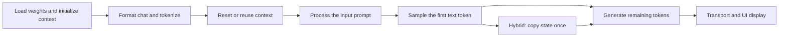

# Exact workloads and timing boundaries

The benchmarks compare local execution paths for the same GGUF. They are not a general model-quality leaderboard or a comparison against a cloud assistant. All real-task text is synthetic. The complete inputs are published in [workloads.json](../evidence/workloads.json) and [the Harbor document](../evidence/project-harbor.txt).

## Fixed input/output counts

The new Ornith Q4, Ornith Q2 SDK and Raptor handoff tests use 512 integer input token IDs drawn with `random.Random(42)` from 0 through 31999, followed by exactly 128 generated tokens. EOS is ignored for this controlled workload. There is one warm-up and three measured runs; the warm-up is excluded from the headline medians.

This sequence is deliberately synthetic, not a readable document. Identical token-ID integers can mean different text in different vocabularies. Within a model's CPU/accelerator comparison, the same IDs and weights are used. This controls token counts without asserting equal semantic difficulty between different models or expert-routing distributions representative of every real prompt.

The earlier small Qwen tool used one warm-up and five measured repetitions. Its raw parameters, counts and native counters are retained, but the exact generated input IDs and a whole-response wall timer were not retained. The earlier Raptor tool also used its own generator; the saved tool version and parameters remain evidence, rather than silently claiming the new Python harness generated those older inputs.

## Real text tasks

Every request in the new comparisons begins with `Request 1.`, `Request 2.` or `Request 3.`, then a newline. The prefix keeps the stimulus consistent with the earlier tests. New native tests clear context before each request; no cached prefix is reused.

### Friendly meeting reply

```text
Write a friendly reply of 45 to 65 words to this message: "Can we move our project review from Tuesday to Thursday?" Say Thursday works, ask for 14:00, and say you will send the updated agenda on Wednesday. Do not invent any other plans.
```

The output cap is 160 tokens. Actual output length is retained. The word-limit instruction was not an automatic pass/fail gate; some outputs missed it. A shorter completion is therefore not evidence that a backend performed an equal amount of response work.

### Document fact extraction

Read [the complete synthetic Harbor thread](../evidence/project-harbor.txt), followed by two newlines and:

```text
Who owns the approved final Harbor release notes, and when are they due? Reply with only the owner, weekday, and time, separated by vertical bars. Do not include the draft deadline.
```

The expected exact answer is `Maya|Friday|16:00`. The document includes an earlier Thursday-noon draft milestone, a reviewer, and unrelated Cedar/Birch projects. The question tests selecting the final approved milestone and exact formatting. Its output cap is 48 tokens. This is a bounded fact check, not a broad reasoning, knowledge, safety, tool-use or schema benchmark.

### Document summary

Read the same complete thread, followed by two newlines and:

```text
Summarize Harbor in three concise bullets, no more than 90 words total: the final release-notes owner and deadline; the sole landing-page blocker; and the items explicitly deferred or optional. Do not summarize Cedar or Birch.
```

The output cap is 192 tokens. Correct content should cover Maya/Friday/16:00, Finance's pricing-table signoff, and the optional animation/deferred footer issue. Outputs are retained for inspection; the full summary rubric was not used as an automatic quality gate.

## Tokens actually evaluated and produced

Token counts include model-specific chat framing. Raptor's embedded Spark template supplies `you are a helpful assistant.` as its default system message and uses Spark's thinking-disabled tags. The Ornith single-user Qwen framing uses its own empty thinking block. A token is a vocabulary unit, not a word or a billable cloud unit.

| New task | Raptor input tokens | Ornith Q4/Q2 input tokens | Raptor output across modes | Original Q4 output across modes |
|---|---:|---:|---:|---:|
| Meeting reply | 81 | 77 | 36–49 | 57–78 |
| Fact extraction | 750 | 733 | 10 | 10 |
| Summary | 761 | 742 | 66–83 | 104–127 |

Per-repeat counts for every published mode, including Q2, are in [stage-timings.csv](../evidence/stage-timings.csv) and the request JSON. New native visible-output counts exclude an unprinted EOS; older SDK/HTTP counters retain their reported conventions. The earlier native HTTP extraction reported 11 tokens for text for which GenieX reported 10. Comparing those counters without their convention would be misleading.

Context capacity was 2048 tokens. Capacity is not the number automatically consumed by a request. These measurements do not establish behavior at an Osaurus model's larger default context or its advertised maximum training context. Additional agent instructions, tool schemas and conversation history would add tokens.

## Loading, first text and completion



- **Runtime ready**: the model object and context exist. Memory-mapped loading can defer substantial reads until inference. It is not proof every weight is resident in RAM.
- **Initial control response**: first arithmetic answer after construction. The new Raptor control has 32 input tokens and two visible output tokens; Q4's control has 28 input tokens. A tiny MoE prompt does not touch every possible expert weight.
- **Preparation**: chat rendering and tokenization. New Raptor recordings time these separately. They were not separately timed in all earlier tests.
- **Prompt stage**: input evaluation until logits are ready. Raptor records both synchronized wall time and native compute counters.
- **First text**: the first nonempty text fragment becomes available in the native pipeline. It is already inside response total, not a stage to add again. It is not a measurement of pixels appearing in the Osaurus window.
- **Continuation generation**: subsequent single-token decode steps, sampling and token-to-text conversion. New Raptor recordings synchronize decode steps to expose their wall time.
- **State transfer**: the hybrid's saved working state is copied once from the NPU context into the CPU context. Saved/restored byte counts are checked. The transfer is included in hybrid total.
- **Total response**: measured native request wall time. New Raptor real requests also retain preparation-inclusive total. Model construction, JSON-file logging, HTTP transport, GUI rendering and speech output are outside the historical native timers.

Native compute counters overlap with wall-clock stages. Do not add both together. Each headline column is an independent median, so medians also need not form an exact arithmetic identity. Earlier native `t_load_ms` has a different boundary from the outer construction timer; it is not substituted for runtime-ready time. [load-observations.json](../evidence/load-observations.json) preserves available outer measurements and component stages. Missing CSV fields mean not separately recorded, not zero.

### One actual Raptor handoff request

This is the first measured 512/128 handoff repetition. It is an individual run, not a sum of independent medians. Model construction and warm-up happened earlier, and prebuilt token IDs mean formatting/tokenization is outside this fixed request.

| Stage | Time |
|---|---:|
| Context reset | 4.661 ms |
| Prompt processing to logits ready | 809.910 ms |
| Sampling and token-to-text across the response | 30.839 ms |
| One state transfer | 38.729 ms |
| Remaining single-token decoding | 8952.008 ms |
| Other host bookkeeping | 0.536 ms |
| **Request total** | **9836.683 ms** |

First text was available at 815.260 ms, already included in that total. The state copy was 75,510,684 bytes, about 72.0 MiB. The independent median total across three repetitions was 9.48 s; that does not contradict this individual 9.84 s run.

## Comparability limits

The November 15 Q4 and Raptor native comparisons use the same matched native runtime and explicit settings within each model. Q4 disables CPU repacking to fit the mapped large model; Raptor enables it. Q2 uses the matching GenieX model wrapper with different loading defaults and a requested temperature-zero configuration, which is not silently treated as equivalent to the later direct greedy sampler.

Earlier HTTP summaries deliberately followed extraction on the same thread and reused 707 cached tokens in Raptor and 601 in Q4. The new summaries clear context. Those are different workload timings. Earlier Q4 also used Osaurus's b12359 native engine. Cross-table ratios cannot isolate quantization or processor alone.

Cells ran sequentially on a practical laptop. Optional apps were closed, Windows file cache was not forcibly flushed, thermal state was not fixed, and intermittent background Windows AI NPU spikes were reported. Fresh-process model construction is not guaranteed cold-disk loading. There are only three measured repetitions in the new comparisons. Free-form output lengths vary, and no battery energy was measured.

## Memory measurements

Process **full working set**, private committed bytes and free system RAM are different measurements. During a mapped Q4 run, full working set was about 8.67 GiB while private working set was only 159 MiB. That explains why Task Manager's default private-memory column did not account for all physical RAM used by the model. Shared/mapped pages, driver allocations and other system memory matter.

The Raptor hybrid's peak full working set includes loading and inference; it is not a steady-residency claim. Half-second sampling can miss shorter peaks. A 512 MiB free-system-commit guard was used while allowing reclaimable mapped-file cache pressure. That guard is not proof of comfortable physical RAM headroom or a substitute for testing recovery.

Microsoft references: [Task Manager memory columns](https://blogs.windows.com/msedgedev/2021/01/13/investigate-microsoft-edge-memory-usage/) and [working sets](https://learn.microsoft.com/en-us/windows/win32/memory/working-set).
